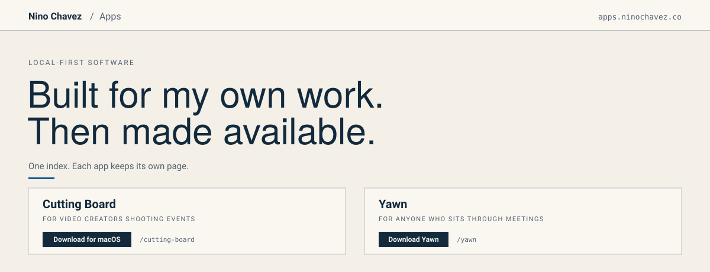

# apps-ninochavez

The index page at **[apps.ninochavez.co](https://apps.ninochavez.co)**. One page,
one job: say what these apps have in common and send you to the right one.

It does not host the apps. Each app keeps its own Pages project and its own page,
and [`apps-ninochavez-router`](https://github.com/nino-chavez/apps-ninochavez-router)
maps a path onto it.

## What's here

```
index.html              the whole site
assets/readme/          the hero above
```

One file, no build step, no dependencies. Open `index.html` to work on it.
The Yawn card is the exception: its public product copy and release metadata
load from Yawn's published `app-card.json` manifest. Keep the local fallback
generic and accurate; do not add a second hard-coded Yawn version here.

## Deploy

Push to `main`. The Cloudflare Pages project `apps-ninochavez-git` is connected to
this repo and publishes the repo root on every push (no build step). Pull requests
get preview deployments.

The custom domain is served by the router Worker (`platform/apps-ninochavez-router`),
not by this project directly. The router fetches everything except the app routes
from `apps-ninochavez-git.pages.dev`, so a push here changes the index and nothing
else.

The old direct-upload project `apps-ninochavez` is no longer used. It is kept only
as a rollback target.

## Adding an app

Copy a `<article class="card">` block in `index.html` and fill in three things,
because those are the three questions a visitor actually has:

| Line | Answers |
|---|---|
| `.for` | who it is for |
| `.what` | what it does |
| `.foot` | what to do next |

Then add the route in the router repo. The grid wraps on its own; no layout work
is needed for a third or fourth card.

## Design

Nino selected **Harbor & vermilion** for the Apps index on November 2, 2026,
from the November 1 desktop and mobile comparison. Sea-glass fields repeat in
the introduction and footer; blue-green actions and small vermilion labels
identify this index independently of the apps it lists.

| Token | Value |
|---|---|
| Ink | `#172F3E` |
| Paper | `#F5F0E7` |
| Surface | `#FFFCF7` |
| Muted | `#50636A` |
| Action / link | `#1F6373` |
| Action hover | `#174A57` |
| On action | `#FFFFFF` |
| Field | `#DEEAE8` |
| Vermilion | `#A63E2F` |
| Heading | `#123E4B` |
| Rule | `#ADBEBB` |

The selected comparison also supplies mobile gutters, wrapped navigation,
a compact introduction and visible keyboard focus. Typography, card order,
screenshots, destinations and the live Yawn manifest remain as before.
No animation is added; the page keeps its light appearance in either system theme.

Near-zero corner radius, narrow display face over Inter, no shadows.

## License

MIT.
